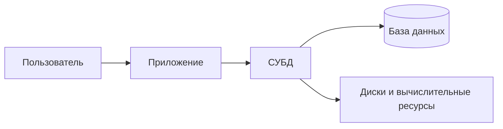

# Одна запись — несколько копий

Представь библиотеку: список книг хранится в таблице у библиотекаря, выдачи — в файле у администратора, читатели — в третьем файле. Книга переименована, но обновили только один список. Как понять, какая запись верна? Когда два человека одновременно правят файл, кто сохранит свою версию? Задача не в том, чтобы «сложить данные в одну папку», а в том, чтобы согласованно хранить и изменять связанные сведения.

**База данных (БД)** — организованная совокупность взаимосвязанных данных о предметной области, например о книгах, читателях и выдачах. **Система управления базами данных (СУБД)** — программное обеспечение, которое определяет структуру БД, хранит данные, выполняет запросы, проверяет ограничения и управляет совместным доступом. База — это данные; СУБД — инструмент для работы с ними. PostgreSQL — СУБД, а конкретная база библиотеки — набор данных, которыми она управляет.

**Система баз данных** шире: она объединяет данные, СУБД, оборудование, прикладные программы, правила работы и людей. Если в вопросе написано «информационная система», уточни контекст: в широком смысле туда входят ещё процессы организации, а не только файлы и сервер.

```quiz
id: db-vs-dbms
question: Что в примере библиотеки является СУБД?
options:
  - text: Записи о книгах, читателях и выдачах
    why: Это содержимое базы, а не программа, которая им управляет.
  - text: Программа, хранящая записи и проверяющая правила их изменения
    correct: true
  - text: Вся библиотека вместе с сотрудниками и оборудованием
    why: Это ближе к информационной системе; СУБД — только её программная часть.
explain: БД — организованные данные, СУБД — средства управления ими, система БД — всё вместе.
```

# Из чего складывается система

Система БД состоит из **данных** (содержимое и описание структуры), **аппаратного обеспечения** (машины, диски, сеть), **программного обеспечения** (СУБД, операционная система, приложения) и **пользователей** (администраторы, разработчики, сотрудники и другие конечные пользователи). Схема взаимодействия не сводится к «человек открывает файл»:



**Назначение СУБД** — дать единое управляемое место для данных: хранить их независимо от отдельных программ, предоставлять удобный поиск и изменение, разрешать одновременную работу и защищать от нарушения правил и потери. СУБД не делает данные автоматически правильными: правила нужно сформулировать, а права — настроить.

```quiz
id: components
kind: multiple
question: Какие составляющие входят в систему БД, а не только в саму БД?
options:
  - text: Данные
    correct: true
  - text: Серверное оборудование
    correct: true
  - text: СУБД и прикладные программы
    correct: true
  - text: Люди, которые проектируют и используют систему
    correct: true
  - text: Только таблицы с записями
    why: Таблицы — часть данных, но не вся система.
explain: Система объединяет данные, аппаратные и программные средства, пользователей и правила работы.
```

# Проверь на новом примере

Для сервиса записи к врачу отдели сведения о приёмах от программы, которая их хранит, и от всей информационной системы клиники. Если сервер сломался — изменилось оборудование; если врач перенёс приём — изменились данные; если добавили проверку двойной записи — изменилось поведение приложения или СУБД и его правила.

```quiz
id: appointment
question: Врач перенёс приём, а система отклонила перенос из-за пересечения расписания. Что обеспечило проверку правила?
options:
  - text: Сам факт наличия таблицы приёмов
    why: Данные не проверяют себя без программного ограничения или логики приложения.
  - text: Логика приложения или ограничение, выполняемое СУБД
    correct: true
  - text: Физический диск сервера
    why: Диск хранит биты, но не проверяет бизнес-правила.
explain: Правило задают в приложении или в схеме БД; СУБД может обеспечивать его при записи.
```

# Образцы полного ответа

Сначала попробуй ответить самостоятельно. Образец задаёт полноту ответа, а не обязательный дословный текст.

## Вопрос 1. Система баз данных (информационная система)

Система баз данных — компьютеризированная система хранения и обработки информации, которая содержит данные и предоставляет их по требованию. Она включает сами данные, аппаратное обеспечение, программное обеспечение и пользователей. БД — организованная совокупность взаимосвязанных данных; система БД шире базы и включает средства и людей, обеспечивающих её работу. Например, система библиотеки — это сведения о книгах и выдачах, сервер с СУБД, программа библиотекаря и её пользователи.

## Вопрос 2. Система управления базами данных (СУБД)

СУБД — программное обеспечение, предназначенное для определения, использования и изменения данных базы одним или несколькими пользователями. Она предоставляет средства описания структуры, запросов, совместной работы, защиты и восстановления. База данных — сами организованные данные, а СУБД — управляющее ими ПО. Например, PostgreSQL является СУБД, а записи о книгах конкретной библиотеки образуют её БД.

## Вопрос 3. Назначение СУБД

Назначение СУБД — обеспечить удобное и надёжное управление данными, скрыв от приложений детали их физического хранения. Для этого она разграничивает доступ и обеспечивает секретность; проверяет заданные ограничения целостности и непротиворечивости; синхронизирует одновременную работу пользователей; предоставляет защиту от последствий отказов и механизмы восстановления. Например, два библиотекаря могут одновременно работать с выдачами, но операции должны сохранять заданные правила и права доступа. Наличие СУБД не заменяет настройку этих правил и резервного копирования.

## Вопрос 4. Основные компоненты системы баз данных

Четыре компонента системы БД: данные, аппаратное обеспечение, программное обеспечение и пользователи.

Данные — информация, зафиксированная в форме, пригодной для обработки, передачи и хранения. Интегрированные данные объединяют сведения разных файлов в согласованную базу; общие данные могут совместно использоваться несколькими пользователями. Входные данные поступают в систему, выходные — выдаются в виде результатов и сообщений.

Аппаратные средства: накопители, процессоры, оперативная память и сеть. Программные: СУБД, утилиты, средства разработки приложений, проектирования БД и генераторы отчётов. Пользователи: прикладные программисты создают приложения, конечные пользователи решают свои задачи через них, администраторы организуют работу БД. Например, запрос о просроченных книгах — вход, список должников — выход; одними сведениями о книгах пользуются разные сотрудники.
