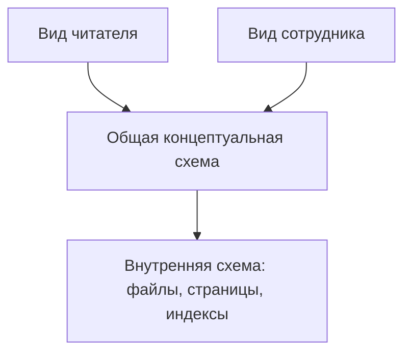

# Один набор данных — разные взгляды

Читателю библиотеки нужен список его книг и сроков возврата; сотруднику — список всех выдач; программе хранения — адреса блоков на диске. Все работают с одной БД, но им не нужно видеть одинаковые детали. Поэтому в трёхуровневой архитектуре ANSI/SPARC различают:

- **Внешний уровень (external / view):** отдельные представления для разных пользователей и приложений. Читатель видит свои выдачи, а не личные данные всех читателей.
- **Концептуальный уровень (conceptual / logical):** общая логическая структура всей БД: какие сущности, данные, связи и ограничения существуют. Это описание не обязано повторять экран приложения или раскладку файла.
- **Внутренний уровень (internal / physical):** как данные организованы для хранения и доступа: файлы, страницы, индексы, способы размещения.

Между соседними уровнями нужны **отображения**: СУБД переводит запрос к представлению в операции над общей схемой, а затем в доступ к хранимым данным. Запомни направление: внешний — *что видит конкретный пользователь*, концептуальный — *что описано в базе в целом*, внутренний — *как это хранится*.



```quiz
id: level-match
kind: match
question: Где описана каждая вещь?
pairs:
  - { left: Видны только мои выдачи, right: Внешний уровень }
  - { left: Книга связана с выдачей и читателем, right: Концептуальный уровень }
  - { left: Поиск ускоряет индекс на диске, right: Внутренний уровень }
explain: Вид пользователя, общая логика и физическая организация отвечают на разные вопросы.
```

# Что не следует путать

Внешний уровень — не обязательно браузерный интерфейс: это *представление данных* для конкретной роли. Концептуальный уровень — не набор всех экранов: он описывает единую предметную область. Внутренний уровень — не просто «сервер»: физический сервер может хранить страницы и индексы, но термин называет способ организации данных, а не количество компьютеров.

Схема из трёх уровней — архитектурная модель, а не требование иметь ровно три машины. К архитектуре клиент/сервер вернёмся позднее; одинаковое число «три» там обозначает иное разделение.

```quiz
id: three-computers
question: Сотрудник видит только свои филиалы, а на сервере БД появился новый индекс. Какие уровни изменились непосредственно?
options:
  - text: Представление сотрудника — внешний; индекс — внутренний
    correct: true
  - text: Представление сотрудника — внутренний; индекс — концептуальный
    why: Вид данных не равен их хранению, а индекс — физический способ доступа.
  - text: Оба изменения относятся к концептуальному уровню
    why: Общая структура данных могла остаться прежней.
explain: Три уровня различают по назначению описания, а не по компьютеру, на котором оно находится.
```

# Образцы полного ответа

Сначала попробуй ответить самостоятельно. Образец задаёт полноту ответа, а не обязательный дословный текст.

## Вопрос 5. Уровни абстракции в СУБД

В трёхуровневой архитектуре ANSI/SPARC внешний уровень описывает данные для отдельных пользователей и приложений; концептуальный — общую логическую структуру всей БД, связи и ограничения; внутренний (физический) — хранение и методы доступа. Между уровнями задаются отображения. Например, читатель видит только свои выдачи, концептуальная схема содержит читателей, книги и выдачи, а внутренняя — страницы и индексы. Между внешним и концептуальным уровнями обеспечивается логическая независимость, между концептуальным и внутренним — физическая. Это уровни описания данных, а не число компьютеров.
