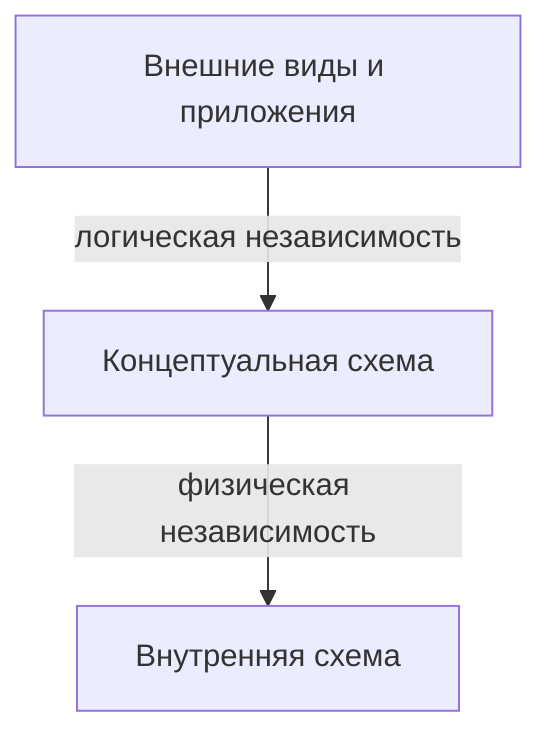

# Переставили мебель — адрес книги не поменялся

У базы был медленный поиск по номеру читателя. Администратор добавил индекс и перенёс файлы на другой диск. Приложение по-прежнему запрашивает те же атрибуты по тому же интерфейсу. Это **физическая независимость данных**: изменения внутренней организации не вынуждают менять концептуальную схему и прикладные программы. Граница — между внутренним и концептуальным уровнями.

Позже предметную область расширили: у книги появился атрибут `язык`, а старому приложению он не нужен. Его внешний вид и запросы могут остаться прежними, если СУБД и разработчики сохранили совместимое отображение. Это **логическая независимость данных**: изменение концептуальной схемы не обязательно ломает внешние представления и программы. Граница — между концептуальным и внешним уровнями.



Независимость — возможность *изолировать определённые изменения*, а не магическое обещание пережить любое переименование или удаление столбца. Удаление нужного приложению атрибута без совместимого вида всё равно сломает запрос. Логическая независимость обычно сложнее физической: меняется сам смысл доступных данных, а не только их размещение.

```quiz
id: independence-match
kind: match
question: Какой вид независимости нужен в каждом случае?
pairs:
  - { left: Перенесли страницы на другой диск без изменения запросов, right: Физическая }
  - { left: Изменили общую схему и сохранили старый вид для приложения, right: Логическая }
explain: Физическая защищает от изменения хранения; логическая — от совместимых изменений общей структуры.
```

# Языки описания — по своим уровням

Чтобы определить структуру, нужны средства **описания данных** (DDL, Data Definition Language). Внешнее описание задаёт доступные пользователю виды; концептуальное — общую структуру; внутреннее — размещение и методы доступа. В учебной трёхуровневой модели можно говорить о внешнем и внутреннем языках определения данных как о средствах описания соответствующих схем. В реальной реляционной СУБД они могут быть возможностями одного SQL-диалекта, а не двумя отдельными программами.

Если внешний язык заставляет пользователя указывать адрес дискового блока, физической независимости не получится. Нужны отображения между уровнями: пользователь формулирует, *какие данные* ему нужны, а СУБД решает, *как* их получить. Подробности физической схемы — в [следующем разделе](lesson:physical/storage).

```quiz
id: ddl-levels
question: Почему запрос приложения не должен указывать номер страницы на диске?
options:
  - text: Потому что тогда изменение хранения потребует изменить приложение
    correct: true
  - text: Потому что страницы принадлежат внешней схеме
    why: Страницы описывают внутреннюю, а не внешнюю организацию.
  - text: Потому что SQL не умеет хранить данные
    why: SQL используется для определения и обработки данных; дело в разделении уровней.
explain: Разделение языков и отображений сохраняет физическую независимость.
```

# Образцы полного ответа

Сначала попробуй ответить самостоятельно. Образец задаёт полноту ответа, а не обязательный дословный текст.

## Вопрос 19. Понятие независимости данных

Независимость данных — возможность менять описание или организацию данных на одном уровне без вынужденного изменения соседнего более высокого уровня и приложений. Она обеспечивается разделением схем и отображениями между ними. В файловых системах детали формата и доступа часто встроены в код программы, поэтому их изменение требует переписывать код. В архитектуре СУБД различают физическую и логическую независимость. Например, добавление индекса меняет способ поиска, но не запрос приложения. Независимость не означает, что удаление необходимого приложению атрибута всегда пройдёт бесследно.

## Вопрос 20. Физическая независимость данных

Физическая независимость — возможность изменять внутреннюю схему, не меняя концептуальную схему и приложения. Её обеспечивает отображение между концептуальным и внутренним уровнями. Например, можно добавить индекс, переместить файлы на другой носитель или изменить размещение страниц, сохранив тот же логический запрос и результат. Изменение типа или допустимого размера логического атрибута не является автоматически чисто физическим изменением: оно может затронуть структуру и код приложения.

## Вопрос 21. Логическая независимость данных

Логическая независимость — возможность совместимо менять концептуальную схему, сохраняя внешние схемы и работающие с ними приложения. Она обеспечивается отображениями между внешним и концептуальным уровнями. Например, к сущности книги добавили необязательный атрибут «язык», а старое представление по-прежнему возвращает только id и название; приложение может не изменяться. Если убрать нужный атрибут без совместимого отображения, независимость не обеспечена. Это независимость внешних схем от общей логической структуры, а не просто возможность менять одну программу независимо от другой.
