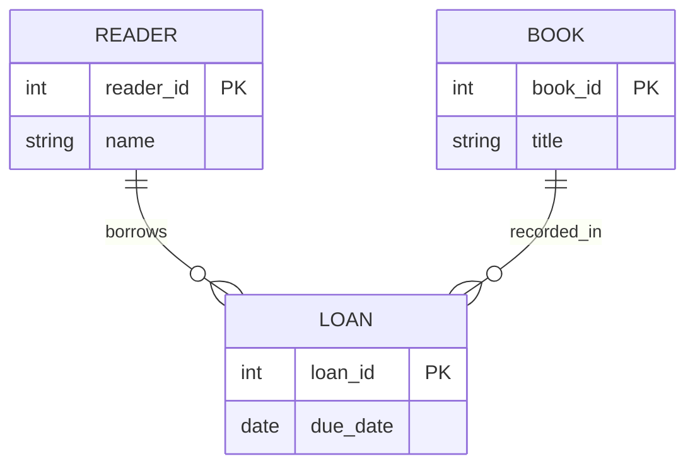

# Сначала смысл, потом таблицы

В библиотеке есть книги, читатели и выдачи. До решения, сколько будет таблиц и индексов, полезно обсудить *что существует* и *как связано*. Для этого применяют модель «сущность — связь» (**ER**, Entity–Relationship). Её схема служит общим языком для заказчика и разработчика: можно заметить пропущенную сущность или неоднозначную связь до написания SQL.

**Сущность (объект)** — различимая вещь предметной области: конкретный читатель. **Тип сущности** — класс таких вещей: `Читатель`; **экземпляр** — одна запись об отдельном читателе. **Атрибут** описывает свойство типа: номер, имя, дата регистрации. **Ключ** — атрибут или сочетание атрибутов, позволяющее отличить один экземпляр от другого. Номер читателя подходит, имя — нет: два человека могут иметь одно имя.

**Слабая сущность** не имеет полного самостоятельного идентификатора и зависит от другой сущности. Например, `СтрокаВыдачи` может иметь номер строки лишь *внутри конкретной выдачи*; пара `(номер выдачи, номер строки)` отличает её от остальных. Это учебный пример зависимости идентификации, а не правило, что любая таблица с внешним ключом автоматически слабая.



```quiz
id: er-objects
question: В модели библиотеки чем является «читатель с номером 42»?
options:
  - text: Типом сущности
    why: Тип объединяет всех читателей; номер 42 указывает на один экземпляр.
  - text: Экземпляром сущности Читатель
    correct: true
  - text: Атрибутом сущности Книга
    why: Читатель — самостоятельный объект предметной области.
explain: Тип — категория, экземпляр — конкретный представитель, атрибут — свойство.
```

# Сильные и слабые стороны ER

Преимущество ER-модели — наглядно показывает объекты, свойства и связи независимо от конкретного способа хранения. На схеме легко обсудить, что означает «выдача» и можно ли выдать одну книгу несколько раз. В учебном ответе отдельно выделена сложность формальной оптимизации модели из-за её тесной связи с семантикой предметной области. Кроме того, это прежде всего модель предметной области: она сама не задаёт индексы, транзакции, точные способы хранения и не снимает всех неоднозначностей без явно записанных правил. Большие диаграммы перегружаются, поэтому их разбивают на области и дополняют текстом.

> [!NOTE]
> Сущность ER и отношение реляционной модели связаны при проектировании, но не являются синонимами. Связь M:N, например, часто превращается в отдельную таблицу.

```quiz
id: er-purpose
question: Что ER-диаграмма поможет выяснить до выбора индексов?
options:
  - text: Какие объекты и связи существуют в предметной области
    correct: true
  - text: Какие страницы диска займёт каждое значение
    why: Это вопрос физического хранения, не концептуального моделирования.
  - text: Какой порядок выполнения выберет оптимизатор для SQL-запроса
    why: План выполнения относится к работе конкретной СУБД с запросом.
explain: ER-модель помогает согласовать смысл данных до реализации.
```

# Образцы полного ответа

Сначала попробуй ответить самостоятельно. Образец задаёт полноту ответа, а не обязательный дословный текст.

## Вопрос 9. ER-модель: особенности, преимущества и недостатки

ER-модель («сущность — связь») описывает концептуальную схему предметной области через типы сущностей, атрибуты, ключи и связи. Её преимущество — наглядное описание семантики и условий целостности, удобное для обсуждения с пользователями. Недостаток, выделенный в учебном ответе, — сложность формальной оптимизации: описание тесно связано с особенностями предметной области, а не с универсальной алгеброй операций. ER-диаграмма сама не выбирает индексы и алгоритмы исполнения. Например, на схеме библиотеки легко увидеть связь читателей с выдачами, но скорость поиска просрочек нужно обеспечивать отдельно.

## Вопрос 10. Описание предметной области с помощью ER-модели

Объект (сущность) — различимый объект реального или абстрактного мира. Тип объекта описывает общие свойства, экземпляр — конкретный объект этого типа. Атрибут — отдельное свойство, а его значение характеризует экземпляр. Ключ — атрибуты, значения которых однозначно идентифицируют экземпляр. В ER-модели слабая сущность зависит от владельца и не имеет полного самостоятельного ключа; сильная имеет самостоятельную идентификацию.

Например, «Заказ» с ключом order_id — сильная сущность. «СтрокаЗаказа» с атрибутами номер_строки и количество — слабая: номер 1 уникален только внутри заказа; полный ключ — (order_id, номер_строки). Заказ №42 и его строка №1 — экземпляры. Не всякая сущность с внешним ключом является слабой.
