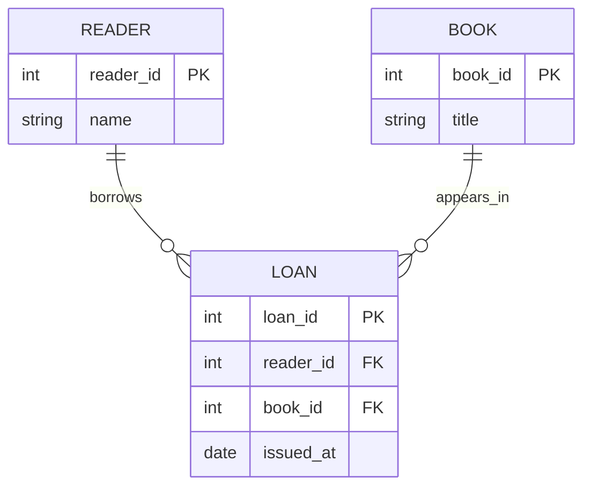

# Сколько объектов может быть связано?

**Связь (relationship)** — осмысленная ассоциация сущностей. `Читатель берёт Книгу` описывает факт, а не просто соседство на рисунке. Для проверки смысла задай вопрос в обе стороны: «Сколько книг может взять один читатель?» и «Сколько читателей могут быть связаны с одной книгой?». Без указания периода времени ответ может меняться: один экземпляр книги выдаётся одному человеку *одновременно*, но за год — многим.

**Кратность (cardinality)** описывает максимальное число связанных экземпляров:

| Вид | Пример | Как читать |
|---|---|---|
| 1:1 | Человек — действующий пропуск | одному пропуску соответствует один владелец |
| 1:N | Издательство — изданные книги | одно издательство выпускает много книг |
| M:N | Читатель — книги за всё время | многие читатели берут многие книги |

Минимальное участие — отдельный вопрос: у читателя может ещё не быть выдач (0), хотя максимальная кратность связи 1:N. На диаграмме указывай сторону каждого «много»: у одного издательства много книг, но у книги в упрощённой модели одно издательство.

```quiz
id: cardinality
question: Один читатель может иметь много выдач, каждая выдача принадлежит одному читателю. Какова кратность от Читателя к Выдаче?
options:
  - text: 1:1
    why: Один читатель не ограничен одной выдачей.
  - text: 1:N
    correct: true
  - text: M:N
    why: Одна выдача в этом примере не относится сразу к нескольким читателям.
explain: Сначала зафиксируй правило предметной области, потом ставь кратности у концов связи.
```

# Как из связи получается схема

Пусть `Читатель(id)` и `Книга(id)`, а читатель может брать много книг за всё время. Если хранить `reader_id` прямо в книге, старое значение исчезнет при следующей выдаче. Введи `Выдача(id, reader_id, book_id, дата, срок)`: каждый факт выдачи связывает одного читателя с одной книгой в определённое время. Таким образом, связь M:N с собственными атрибутами становится отдельным объектом реляционной схемы; две связи 1:N ведут к `Выдаче`.

**ER-диаграмма** обозначает типы сущностей, их атрибуты и связи с кратностями. Есть разные нотации: прямоугольники/ромбы в классическом варианте, «вороньи лапки» в других. На защите важнее однозначно объяснить смысл и кратность, чем угадать конкретную форму значка без указания принятой нотации.

```quiz
id: loan-model
question: Почему для истории выдач недостаточно хранить только текущий `reader_id` у книги?
options:
  - text: При новой выдаче потеряется связь с предыдущим читателем и дата события
    correct: true
  - text: Потому что связь 1:N нельзя описать ключом
    why: Внешний ключ подходит для 1:N; проблема здесь в необходимости хранить отдельные события во времени.
  - text: Потому что у читателя не может быть больше одной книги
    why: Это противоречит условию предметной области.
explain: Каждая выдача — самостоятельный факт с датой, участниками и сроком.
```

# Образцы полного ответа



На схеме READER — читатель, BOOK — книга, LOAN — факт выдачи. Два ребра читаются как «одному читателю — ноль или много выдач» и «одной книге — ноль или много выдач за всё время». Маркер PK обозначает ключ, FK — внешний ключ.


Сначала попробуй ответить самостоятельно. Образец задаёт полноту ответа, а не обязательный дословный текст.

## Вопрос 11. Связи между объектами и виды связей

Связь — отношение между экземплярами сущностей, формально подмножество декартова произведения соответствующих множеств. Связь может быть бинарной, связывать больше двух типов или экземпляры одного типа. По максимальной кратности различают 1:1, 1:N (обратно N:1) и M:N. В модели больницы: пациент и занимаемое место — 1:1 в фиксированный момент; палата и места — 1:N; пациенты и лечащие хирурги — M:N, если одного пациента могут лечить несколько хирургов. Участие 0 или 1 задаётся отдельно от максимальной кратности. Для связи «сотрудник руководит сотрудником» оба участника имеют один тип.

## Вопрос 12. Диаграмма сущностей и связей: пример и объяснение

Пример диаграммы: Читатель (reader_id — ключ, имя) 1 — N Выдача (loan_id — ключ, дата, reader_id, book_id) N — 1 Книга (book_id — ключ, название). Каждый факт выдачи относится к одному читателю и одной книге; у читателя может быть много выдач, одна книга участвует во многих выдачах за всё время. Через Выдачу реализуется связь M:N между читателями и книгами. В классической нотации Чена сущность рисуют прямоугольником, связь — ромбом, атрибут — овалом, ключевой атрибут подчёркивают. На рисунке нужно обозначить сущности, атрибуты, ключи, названия связей и кратности с обеих сторон; минимальное участие может быть нулевым. Рисунок смотри в этом уроке и попробуй воспроизвести на бумаге. Пример описывает историю выдач, а не одновременную выдачу одного экземпляра нескольким людям.
