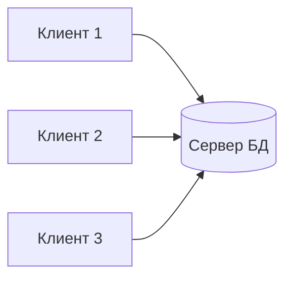

# Кто обслуживает запрос

В архитектуре **клиент/сервер** клиент инициирует запрос и показывает результат, сервер предоставляет общую услугу: доступ к данным, обработку запроса, контроль правил. Клиентом может быть программа на рабочем месте; сервером БД — процесс СУБД на другой машине. Это роли взаимодействия, а не названия моделей данных: один компьютер может выступать сервером для одних программ и клиентом другого сервиса.

**Один сервер:** клиенты запускаются на отдельных машинах, сервер СУБД — на одной. Плюсы: общий источник данных, удобное централизованное администрирование, параллельная работа клиентов и возможность выделить мощное оборудование под БД. Минусы: при росте нагрузки сервер становится узким местом; без резервирования его отказ лишит клиентов доступа. Распределена *обработка между клиентами и сервером*, но сама БД не обязана быть распределённой между машинами.



```quiz
id: one-server
question: Три клиента обращаются к одной машине с СУБД. Что можно утверждать наверняка?
options:
  - text: Работа разделена между клиентами и сервером, но данные могут храниться на одном сервере
    correct: true
  - text: Данные непременно распределены по трём клиентам
    why: Клиенты могут лишь посылать запросы к общей БД.
  - text: Сбой любого клиента удалит базу на сервере
    why: Сбой клиента не равен потере серверного хранилища.
explain: Не путай распределённую обработку и распределённое хранение.
```

# Несколько серверов — два режима доступа

Если часть данных размещена на нескольких серверах, возможны разные способы доступа. В простом варианте приложение выбирает конкретный сервер и само знает, где какие данные: один запрос к одному серверу не соберёт результат со всех автоматически. В интегрированном варианте система предоставляет единый логический доступ, а местоположение частей скрыто от клиента; запросы координируются между серверами. Это сложнее: нужно учитывать сеть, согласованность, обмен и отказы.

Наличие двух серверов само по себе ещё не делает систему «единой распределённой БД». Описывай, **видит ли клиент местоположение данных** и **умеет ли система сочетать данные нескольких серверов в одном логическом запросе**. Высокая отказоустойчивость тоже не возникает автоматически: если оба сервера хранят разные незаменимые части, отказ одного нарушит доступ к его данным. Репликация и резервирование требуют отдельного проекта.

```quiz
id: multi-server
question: Приложение должно само выбирать сервер для каждого запроса. Скрыта ли от приложения физическая локализация данных?
options:
  - text: Нет, приложение зависит от того, где находится нужная часть данных
    correct: true
  - text: Да, само число серверов гарантирует прозрачность
    why: Прозрачность требует механизма координации, а не только дополнительных машин.
  - text: Да, потому что все запросы возвращают по одной строке
    why: Число строк результата не решает вопрос локализации.
explain: В распределённой системе БД местоположение частей скрывается общим логическим доступом.
```

# Образцы полного ответа

Сначала попробуй ответить самостоятельно. Образец задаёт полноту ответа, а не обязательный дословный текст.

## Вопрос 25. Архитектура клиент/сервер

Архитектура клиент/сервер разделяет систему на сервер БД (СУБД, предоставляющую операции над данными) и клиентские приложения, использующие её интерфейс. Сервер выполняет основные функции СУБД, клиент инициирует запросы и представляет результат. Клиенты могут быть пользовательскими приложениями, программами поставщика СУБД и служебными средствами. Например, программа библиотекаря обращается к серверу PostgreSQL. «Сервер» здесь прежде всего роль программного обеспечения; один процесс или компьютер может быть сервером для одних участников и клиентом другого сервиса.

## Вопрос 26. Распределённая обработка с одним сервером

При одном сервере СУБД выполняется на одной машине, а клиентские приложения — на других; обработка распределена между клиентами и сервером, но сами данные не обязательно распределены. Плюсы: параллельная работа, специализированное мощное оборудование для БД, настройка клиентских машин под задачи пользователей и совместный доступ к общей базе. Минусы: рост нагрузки может перегрузить сервер; без резервирования его отказ прекращает доступ; масштабирование центрального узла ограничено его ресурсами. Например, несколько библиотечных рабочих мест обслуживаются одним сервером. Потеря данных при отказе не неизбежна: она зависит от характера сбоя и средств восстановления.

## Вопрос 27. Распределённая обработка с несколькими серверами

В системе с несколькими серверами узел может обслуживать одних участников и обращаться как клиент к другим. Есть два режима: приложение обращается к одному серверу за раз и само знает размещение данных; либо серверы доступны как единая логическая БД, а система скрывает местоположение частей и координирует запросы. В первом случае один запрос к одному серверу сам по себе не объединяет данные остальных. Во втором возможны распределённые запросы, но усложняются координация, согласованность и обработка отказов. Например, сведения о филиалах могут лежать раздельно, а общий отчёт собираться системой. Несколько серверов без реплик не гарантируют отказоустойчивость.
