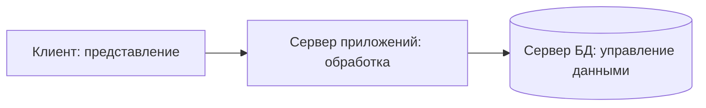

# Приложение между клиентом и БД

Когда интерфейс и вся прикладная логика живут на одном клиенте, обновление правила требует обновить клиентов. В **трёхзвенной архитектуре** роли разделяют: **клиент** представляет данные пользователю; **сервер приложений** выполняет прикладную обработку; **сервер БД** управляет данными. При этом в реальной эксплуатации может быть много экземпляров каждого звена. Три звена — три функциональные роли, а не «строго три компьютера» и не три уровня ANSI/SPARC.



Плюсы: бизнес-правила можно обновлять на сервере приложений; клиенту не нужно знать устройство БД; разные звенья масштабируют и обслуживают отдельно. Минусы: добавляются сеть, развёртывание, координация и зависимость от доступности серверных звеньев. Если промежуточный сервер остановился и нет резервирования, корректно работающая БД всё равно может стать недоступной через приложение.

```quiz
id: tier-match
kind: match
question: Где находится функция в типичной трёхзвенной схеме?
pairs:
  - { left: Форма записи к врачу, right: Клиент }
  - { left: Проверка бизнес-правила расписания, right: Сервер приложений }
  - { left: Сохранение приёма и выполнение запроса, right: Сервер БД }
explain: Представление, прикладная обработка и управление данными распределены по звеньям.
```

# Сравни два разных «три»

Три **уровня абстракции** — внешний, концептуальный, внутренний — отвечают на вопрос «*какой вид описания данных* мы обсуждаем?». Три **звена архитектуры** — клиент, сервер приложений, сервер БД — отвечают на вопрос «*где выполняется функция*?». Представление клиента связано с внешним уровнем, но не равно ему: концептуальная и внутренняя схемы могут обслуживаться одним сервером БД, а вид данных может формироваться на сервере приложений.

```quiz
id: levels-vs-tiers
question: Клиент показывает экран, сервер приложений проверяет правило, сервер БД хранит данные. Что означает «три» здесь?
options:
  - text: Три функциональных звена клиент-серверной системы
    correct: true
  - text: Три экземпляра одной таблицы
    why: Число копий таблицы не определяется разделением функций.
  - text: Только внешний, концептуальный и внутренний уровни ANSI/SPARC
    why: Они разделяют описания данных, а не машины и прикладные функции.
explain: Звенья системы и уровни абстракции — разные классификации.
```

# Образцы полного ответа

Сначала попробуй ответить самостоятельно. Образец задаёт полноту ответа, а не обязательный дословный текст.

## Вопрос 29. Трёхзвенная архитектура клиент/сервер

Трёхзвенная архитектура разделяет представление, прикладную обработку и управление данными между клиентом, сервером приложений и сервером БД. Например, браузер показывает каталог, API проверяет правила выдачи, PostgreSQL хранит записи. Преимущества — более полное использование ресурсов, централизованное изменение бизнес-логики и параллельная работа звеньев; их можно масштабировать отдельно. Недостатки — повышенные требования к надёжности серверов, сетевые взаимодействия и сложность развёртывания. В учебной схеме показаны три ЭВМ; в реальной системе звено — функциональная роль и может иметь несколько экземпляров. Не путать с тремя уровнями абстракции данных ANSI/SPARC.
