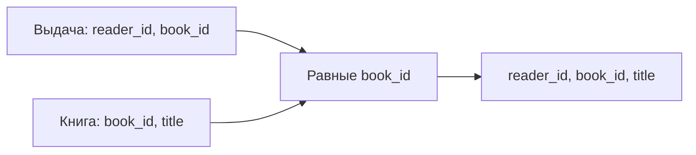

# Строки или столбцы?

Есть отношение `Книга(id, название, год)`. **Селекция** `σ(год > 2020)(Книга)` выбирает *строки* по условию, сохраняя атрибуты. **Проекция** `π(название)(Книга)` выбирает *столбцы*; в математическом отношении одинаковые получившиеся строки сливаются в одну. Вместе: `π(название)(σ(год > 2020)(Книга))` возвращает названия книг после 2020 года.

В SQL соответствующий запрос выглядит так:

```sql
SELECT DISTINCT title
FROM book
WHERE year > 2020;
```

`WHERE` отвечает за отбор строк; `SELECT title` — за столбцы; `DISTINCT` приближает SQL-результат к математической проекции без повторов. SQL без `DISTINCT` может вернуть одно название несколько раз, даже если математическое отношение не содержит повторов.

```quiz
id: select-project
kind: match
question: Что делает каждая операция?
pairs:
  - { left: Селекция σ, right: Выбирает строки по условию }
  - { left: Проекция π, right: Выбирает атрибуты и устраняет дубликаты в алгебре }
  - { left: Декартово произведение ×, right: Создаёт все сочетания строк }
explain: Селекция — строки, проекция — столбцы, произведение — комбинации.
```

# Соедини только связанные строки

Пусть `Выдача(reader_id, book_id)` и `Книга(book_id, title)`. **Естественное соединение** по общему атрибуту `book_id` оставляет только пары кортежей с одинаковым значением этого атрибута и выводит общий атрибут один раз. Если у двух отношений случайно совпадают названия *других* столбцов, естественное соединение сравнит и их — поэтому в реальном SQL часто предпочитают явное `JOIN ... ON`, где условие перечислено прямо.



```quiz
id: join-pair
question: Есть Выдача(1, 7) и Книга(7, «Атлас»). Какой кортеж получается при естественном соединении по book_id?
options:
  - text: (1, 7, «Атлас»)
    correct: true
  - text: (1, 7, 7, «Атлас»)
    why: В естественном соединении общий атрибут book_id выводится один раз.
  - text: (7, «Атлас») и отдельно (1, 7)
    why: Соединение возвращает связанный кортеж, а не два независимых результата.
explain: Совпавший ключ связывает выдачу с книгой, общий атрибут не дублируется в результате алгебры.
```

# Применить идею в SQL

Здесь не нужно заучивать синтаксис ради синтаксиса: задача закрепляет, что условие соединения сопоставляет связанные строки, а проекция оставляет только нужные атрибуты.

```task
id: issued-titles
lang: sql
title: Какие книги выданы
prompt: |
  Выведи **только названия** книг, которые есть в `loans`. Если название повторяется,
  покажи его один раз. Порядок строк не важен.
setup: |
  CREATE TABLE books (id integer PRIMARY KEY, title text NOT NULL);
  CREATE TABLE loans (id integer PRIMARY KEY, book_id integer NOT NULL REFERENCES books(id));
  INSERT INTO books VALUES (1, 'Атлас'), (2, 'Словарь'), (3, 'Атлас'), (4, 'Сборник');
  INSERT INTO loans VALUES (10, 1), (11, 2), (12, 3);
starter: |
  SELECT DISTINCT
solution: |
  SELECT DISTINCT b.title FROM loans l JOIN books b ON l.book_id = b.id;
hints:
  - Соедини `loans` и `books` по id книги, затем оставь `title`.
  - Два экземпляра книги с названием «Атлас» должны дать одно название — используй `DISTINCT`.
```

# Образцы полного ответа

Сначала попробуй ответить самостоятельно. Образец задаёт полноту ответа, а не обязательный дословный текст.

## Вопрос 32. Основные реляционные операции

Пусть A(x)={(1),(2)}, B(x)={(2),(3)}, C(y)={(a),(b)}. Объединение A∪B={(1),(2),(3)}, разность A∖B={(1)}, пересечение A∩B={(2)}; для этих операций нужны совместимые схемы и домены. Произведение A×C={(1,a),(1,b),(2,a),(2,b)} сочетает каждую строку с каждой.

Пусть R(id, имя, возраст)={(1, «Лев», 20),(2, «Лев», 21),(3, «Ира», 19)}. Селекция σ(возраст≥20)(R) оставляет первые два кортежа со всеми атрибутами; проекция π(имя)(R) даёт {(«Лев»),(«Ира»)} без повторов. Для Выдача(reader_id,book_id)={(1,7),(2,8)} и Книга(book_id,title)={(7,«Атлас»),(9,«Словарь»)} естественное соединение даёт {(1,7,«Атлас»)}: совпасть должны значения всех одноимённых атрибутов, каждый общий атрибут выводится один раз. Результат каждой операции — отношение. SQL SELECT без DISTINCT может сохранить повторы, в отличие от математической проекции.
