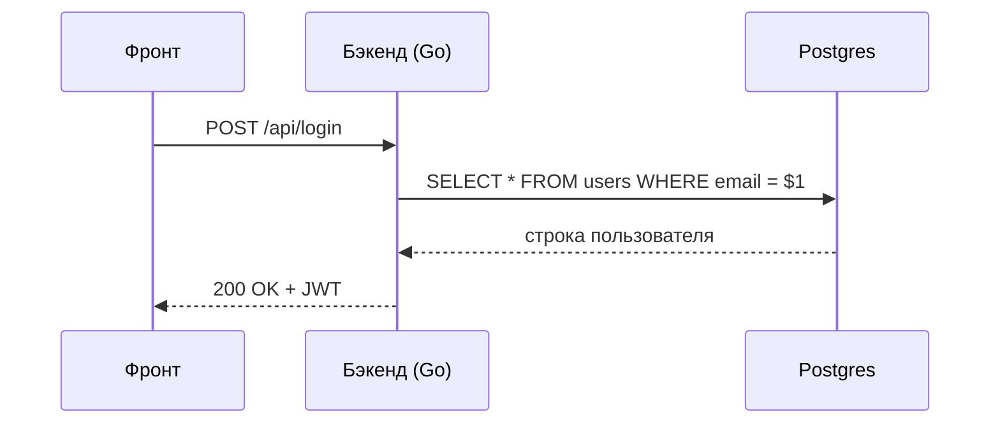

# Как устроен урок

Урок — это последовательность **шагов**, как на Stepik. Каждый шаг начинается с заголовка первого уровня (`# Заголовок`) в Markdown-файле. Сверху урока — плитки шагов: серые ещё не открыты, зелёные пройдены.

Теоретический шаг засчитывается, как только ты его открыл. Шаг с заданием — когда задание решено.

Обычный Markdown работает целиком: **жирный**, *курсив*, `код в строке`, [ссылки](https://go.dev), списки и таблицы.

| Что | Где живёт | Пример |
|---|---|---|
| Курс | `courses/<id>/course.yaml` | этот курс — `demo` |
| Модуль | `modules/01-name/module.yaml` | «Контент» |
| Урок | `modules/01-name/01-lesson.md` | этот файл |

# Выноски

Выноски — это цитата с меткой в первой строке.

> [!NOTE]
> Заметка: нейтральная дополнительная информация.

> [!TIP] Лайфхак
> Совет. Заголовок выноски можно переопределить — как здесь.

> [!WARNING]
> Осторожно: то, на чём часто спотыкаются.

> [!DANGER]
> Опасно: так делать нельзя (например, хранить пароли открытым текстом).

> [!DEEP]
> «Под капотом» — сворачиваемый блок для тех, кому интересно, как это устроено внутри.
> Например: строка в Go — это структура из двух полей, указателя на байты и длины.
> Поэтому `len(s)` работает за O(1), а срез строки `s[2:5]` не копирует данные.

# Код и диаграммы

Обычный блок кода просто подсвечивается:

```go
type User struct {
	ID   int64
	Name string
}
```

А если после языка написать `run`, пример можно запустить и поменять прямо здесь:

```go run
package main

import "fmt"

func main() {
	langs := []string{"Go", "SQL", "Git"}
	for i, l := range langs {
		fmt.Printf("%d. %s\n", i+1, l)
	}
}
```

SQL тоже запускается — на настоящем Postgres внутри браузера. Всё, что выше строки `-- ^ setup`, выполняется незаметно и готовит данные:

```sql run
CREATE TABLE teams (id int, name text, place int);
INSERT INTO teams VALUES (1, 'gophers', 7), (2, 'rivals', 1), (3, 'newbies', 12);
-- ^ setup
SELECT name, place FROM teams ORDER BY place;
```

Статичные схемы рисуются через Mermaid:


